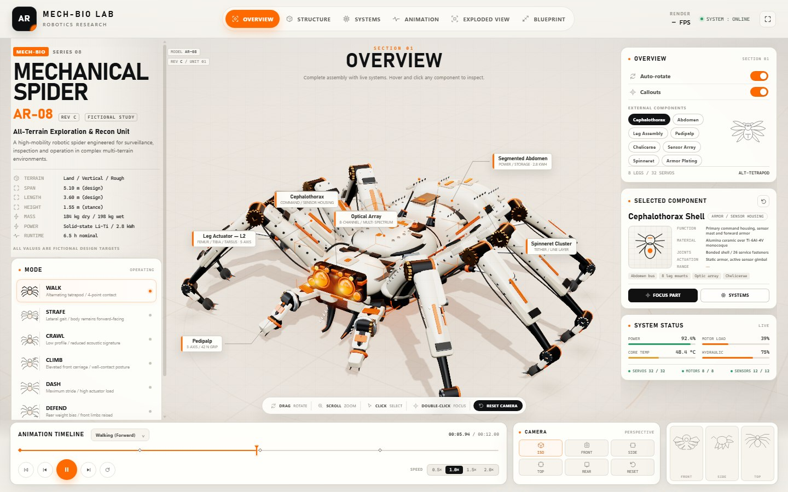
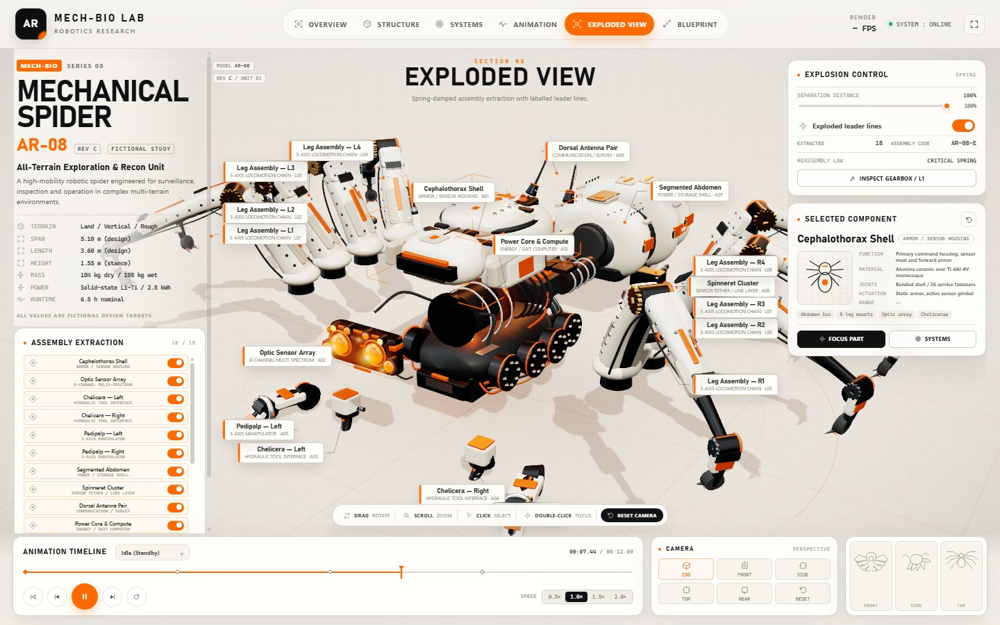

# AR-08 Mechanical Spider

**MECH-BIO / Series 08 — an interactive, self-contained 3D mechanical spider and fictional engineering dashboard.**

[](docs/preview.jpg)

AR-08 is a browser-based design study of a fictional all-terrain reconnaissance spider. The entire simulator — interface, procedural 3D model, materials, animation and telemetry — runs from a single `index.html` file with no server, CDN, fonts, models or textures to load.

The project is intentionally presented as a **fictional engineering study**. Dimensions, materials, loads and telemetry are illustrative design targets, not measurements of real hardware.

## Highlights

- **One-file runtime.** HTML, CSS, application code and Three.js r159 are inlined into `index.html` (about 0.9 MB).
- **Procedural mechanical spider.** An eight-leg, 32-servo-channel rig with segmented armour, joints, pistons, claws and optical assemblies, generated in code at startup.
- **Seven gait modes.** Walk, strafe, crawl, climb, dash, defense and idle, with a gait governor and frequency, stride and foot-lift controls.
- **Interactive inspection.** Hover and click the 3D model, use the eight component chips, inspect materials and connections, focus a part, or enable x-ray, internal scan, wireframe and joint-axis overlays.
- **Six dashboard sections.** Overview, structure, systems, animation, exploded view and blueprint.
- **Exploded assembly.** Spring-damped extraction and reassembly for 18 assembly groups, with leader lines and a separation slider.
- **Blueprint mode.** Orthographic drawing view with isometric, top, front, side and rear presets, X/Y/Z section cuts, dimensional annotations and edge wireframe.
- **Manual joint control.** Override an individual leg's hip yaw, reach and lift, then read back the resulting joint angles and contact state.
- **Timeline transport.** Play/pause, frame step, restart, timeline scrub and 0.5×–2× playback speed.
- **Camera and viewport.** Orbit, pan and zoom; six camera presets; fullscreen; auto-rotate; adaptive pixel-ratio cap on low-power devices.
- **Responsive and accessible.** Desktop dashboard down to a view-focused mobile layout, labelled tabs/switches/sliders, keyboard shortcuts and reduced-motion support.
- **Offline and private.** No network requests at runtime, no analytics, no cookies, no local storage, no third-party embeds.

## Preview

### Overview

[](docs/preview.jpg)

The overview combines the live 3D assembly, component callouts, gait selector, telemetry and camera presets.

### Exploded view

[](docs/exploded.jpg)

The exploded view separates the major assembly groups and labels them with leader lines. Use the separation slider or the Extract All / Assemble controls in the dashboard.

## Quick start

### Run the release

1. Download or clone this repository.
2. Open **`index.html`** in a current browser with WebGL support.

That is the whole runtime. No package install, build step or local server is required, and the page works from `file://`.

### Serve it locally (optional)

If you prefer to serve the folder over HTTP:

```bash
python -m http.server 8080
```

Then open <http://localhost:8080>.

Alternatives such as `npx serve .` or any static file server work as well. Only `index.html` is needed by the browser.

## Controls

| Action | Input |
| --- | --- |
| Orbit the camera | Left-drag in the viewport |
| Pan | Right-drag or Shift + drag |
| Zoom | Mouse wheel |
| Select a component | Click a part or a component chip |
| Focus a component | Double-click a part |
| Play / pause the animation | `Space` or the transport button |
| Step one frame | `←` / `→` |
| Reset the camera | `R` or the Reset camera button |
| Clear selection and pan | `Esc` |
| Enter fullscreen | Fullscreen button in the top-right corner |
| Change gait mode | Mode list on the Overview panel or the timeline selector |
| Change dashboard section | Overview, Structure, Systems, Animation, Exploded View, Blueprint tabs |

On a touch device, dragging orbits the model. Pinch-to-zoom is not implemented.

## Dashboard sections

| Section | What it contains |
| --- | --- |
| **Overview** | Gait mode list, live status, component chips, auto-rotate and callout switches. |
| **Structure** | Assembly hierarchy, mass and rigidity readouts, joint-axis and x-ray shortcuts, L1 gearbox inspection. |
| **Systems** | Simulated power, hydraulic, thermal and render-pipeline telemetry; x-ray/material switches; system bus status. |
| **Animation** | Gait governor, frequency/stride/lift controls, contact-phase groups and manual per-leg IK. |
| **Exploded View** | Extraction list, Extract All / Assemble actions, leader-line switch and separation slider. |
| **Blueprint** | Orthographic drawing views, section cuts, dimensional targets and drawing aids. |

## Animation modes

| Mode | Description |
| --- | --- |
| **Walk (Forward)** | Alternating tetrapod gait with four-point contact. |
| **Strafe (Lateral)** | Lateral gait while the body remains forward-facing. |
| **Crawl (Stealth)** | Low profile and reduced acoustic signature. |
| **Climb (Vertical)** | Elevated front carriage and wall-contact posture. |
| **Dash (High Speed)** | Maximum stride and high actuator load. |
| **Defense (Threat)** | Rear weight bias with the front limbs raised. |
| **Idle (Standby)** | Stationary hold with a low-power sensor sweep. |

## Tech stack

| Layer | Implementation |
| --- | --- |
| Runtime | HTML5, CSS3, vanilla JavaScript |
| 3D | Three.js r159 (vendored UMD build), WebGL, custom GLSL post-processing (ambient occlusion, HDR tone mapping and anti-aliasing; disabled on mobile/low-power devices) |
| 2D | Canvas 2D diagnostics chart; inline SVG icons and component previews |
| Build | PowerShell inliner (`build.ps1`); no Node.js, npm or bundler required |
| Release | Prebuilt, self-contained `index.html` |

The interface uses system fonts only. There are no webfonts, raster textures, imported models or third-party UI libraries.

## Build from source

The prebuilt `index.html` is committed for direct use. Rebuild it after changing anything in `src/`:

```powershell
powershell -NoProfile -ExecutionPolicy Bypass -File .\build.ps1
```

Requirements: Windows PowerShell 5.1 or later (the script uses Windows path separators). The build has no network access and no external dependencies beyond the checked-in `vendor/three.min.js`.

The script inlines `src/style.css`, `vendor/three.min.js` and `src/app.js` into `src/index.template.html`, writes `index.html`, and prints the output size and SHA-256 hash.

### Repository layout

```text
index.html                 Self-contained release build; open this file
src/index.template.html    HTML shell and dashboard markup
src/style.css              Dashboard, responsive and print-like styling
src/app.js                 Three.js scene, IK, animation, controls and UI logic
vendor/three.min.js        Three.js r159, vendored under the MIT license
build.ps1                  Single-file build script
docs/preview.jpg           Overview screenshot
docs/exploded.jpg          Exploded-view screenshot
README.md                  This document
LICENSE                    MIT license for this project
THIRD_PARTY_NOTICES.md     Three.js attribution and license text
```

Do not edit `index.html` by hand for source changes; edit the files under `src/` and rebuild.

## Offline, privacy and security

- **No runtime network access.** The app contains no external scripts, styles, images, fonts or API calls. All rendering data is generated procedurally.
- **No tracking.** There are no analytics, cookies, beacons, local-storage entries or third-party embeds.
- **Content-Security-Policy.** A restrictive CSP is embedded in the document. Network connections, objects, media and form submissions are blocked. Inline styles and scripts are permitted because the release is a single inlined HTML file; there is no `eval` or `new Function` use.
- **WebGL fallback.** If the browser cannot create a rendering context, the app shows a render-core error screen instead of failing silently.

Because the app is a single file, it can be copied to a USB drive, an air-gapped machine or any static host without additional assets.

## Browser support

The automated test runs used **Microsoft Edge (Chromium)**. The app requires a browser that can create a WebGL context; the test environment reported WebGL 2.0.

Microsoft Edge is the verified target for this release. Current Chrome is expected to behave similarly because it shares Chromium, but it was not a separate test target. Firefox and Safari have not been part of a manual or automated cross-browser test matrix, so test them before relying on them. If WebGL is unavailable, the app displays its error screen.

At widths of **860 px or less**, the layout intentionally hides both side rails and the camera card, leaving the 3D viewport, icon-only top tabs, timeline and mode selector. This is a view-focused mobile layout, not the full dashboard.

## Deployment

The repository is a plain static site. No build command, server function, environment variable or secret is required.

### GitHub Pages

1. Push the repository to GitHub.
2. Open **Settings → Pages**.
3. Under **Build and deployment**, choose **Deploy from a branch**.
4. Select the **`main`** branch and the **`/ (root)`** folder, then save.
5. GitHub Pages serves `index.html` at `https://<account>.github.io/mechanical-spider-ar08/`.

No GitHub Actions workflow is needed.

### Vercel

1. Import the repository into Vercel.
2. Choose the **Other** framework preset.
3. Leave the build command empty.
4. If prompted for an output directory, use `.` (the repository root).
5. Deploy. No environment variables are needed.

Vercel serves the root `index.html` as a static page. This repository has not been deployed to Vercel; the steps above are configuration notes.

### Other static hosts

Upload the repository contents to any static host (Netlify, Cloudflare Pages, an S3 bucket, an internal web server, or a local folder). The only file required at runtime is `index.html`.

## Verification

### Automated checks

The release build was exercised in headless Microsoft Edge (Chromium) with a temporary same-origin test harness. All automated checks passed:

- **60 desktop checks** covering startup and WebGL rendering, all six dashboard tabs, all seven animation modes, exploded extraction/assembly and the separation slider, eight component selections plus clear, material/x-ray/wireframe/AO/gait toggles, gearbox inspection, six blueprint views, X/Y/Z section cuts and off, blueprint drawing aids, manual IK enable/selection/pose/reset, timeline play/pause/step/restart/speed/scrub, a camera preset, synthetic pointer orbit and wheel zoom, and uncaught-error capture.
- **8 responsive checks at 390 × 844** and **8 responsive checks at 900 × 900**, covering boot, viewport sizing, horizontal overflow, navigation fit, tab interaction, walking animation and the exploded view.
- **Offline load:** the same `index.html` reached the READY state from `file://` with no external network requests and no uncaught application errors. The only console message was Three.js r159's upstream UMD build deprecation warning.

These are automated smoke and regression checks, not a formal quality certification. Renderer statistics vary by GPU and viewport; no performance figures are claimed here.

### Manual check

Automated headless checks do not replace a hands-on pass. Before relying on the project in production, open it in your target browser and verify:

- Drag, pan, wheel zoom and double-click focus with a real pointer.
- Touch orbit and layout behavior on a physical phone or tablet.
- Fullscreen entry and exit.
- Visual quality and frame rate on your GPU.
- Any browser-specific font or WebGL differences.

No manual cross-browser or physical-device test matrix is claimed for this release.

## Limitations

- **Fictional engineering data.** All dimensions, mass values, materials, loads and telemetry are design-study content. They are not validated hardware specifications.
- **Mobile is view-focused.** Below 860 px, the side panels and camera card are hidden by design; panel-specific controls are unavailable at that size. There is no pinch-to-zoom gesture.
- **No persistence.** Camera, mode and selection state reset on reload. The app does not use cookies or local storage.
- **No audio.** The simulator is visual only.
- **Three.js warning.** The vendored r159 UMD build prints an upstream deprecation warning in the console. It does not affect operation.
- **Adaptive quality.** Post-processing is disabled on low-power/mobile profiles, and the renderer may lower its pixel ratio if frame rate drops. Visual output therefore varies by device.
- **No backend.** There is no data export, sharing, account system or server-side component.

## Credits

- **AI development assistance:** DeepSeek V1 Flash.
- **3D engine:** [Three.js](https://threejs.org/) r159, Copyright 2010–2023 Three.js Authors, MIT license. The vendored build retains its upstream license header; see `THIRD_PARTY_NOTICES.md`.
- **Design and implementation:** the AR-08 project. MECH-BIO and AR-08 are fictional names used for this design study.

## License

This project is released under the **MIT License**. See [LICENSE](LICENSE) for the full text. Three.js remains under its own MIT license; see [THIRD_PARTY_NOTICES.md](THIRD_PARTY_NOTICES.md).
